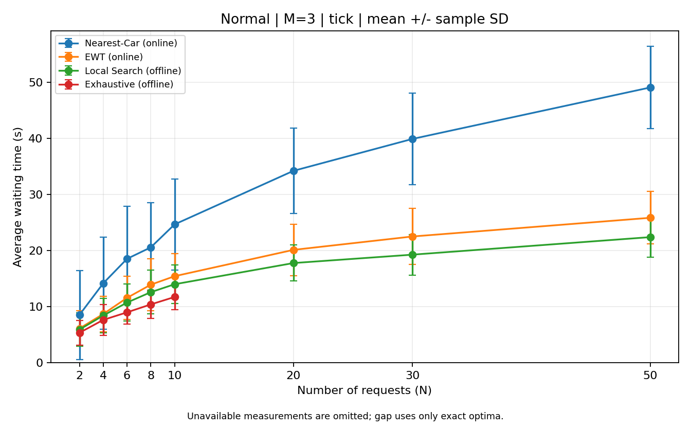
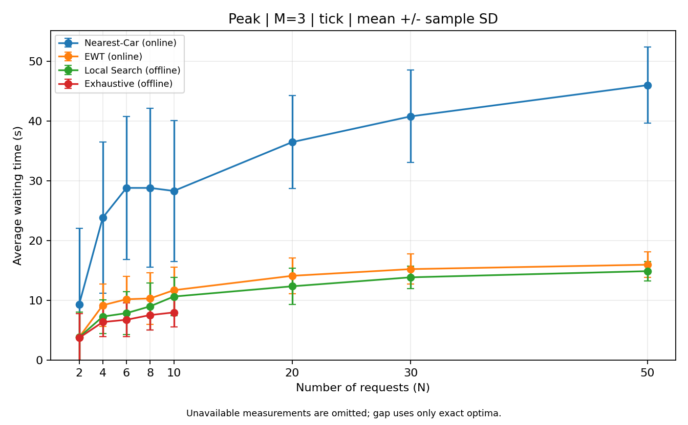
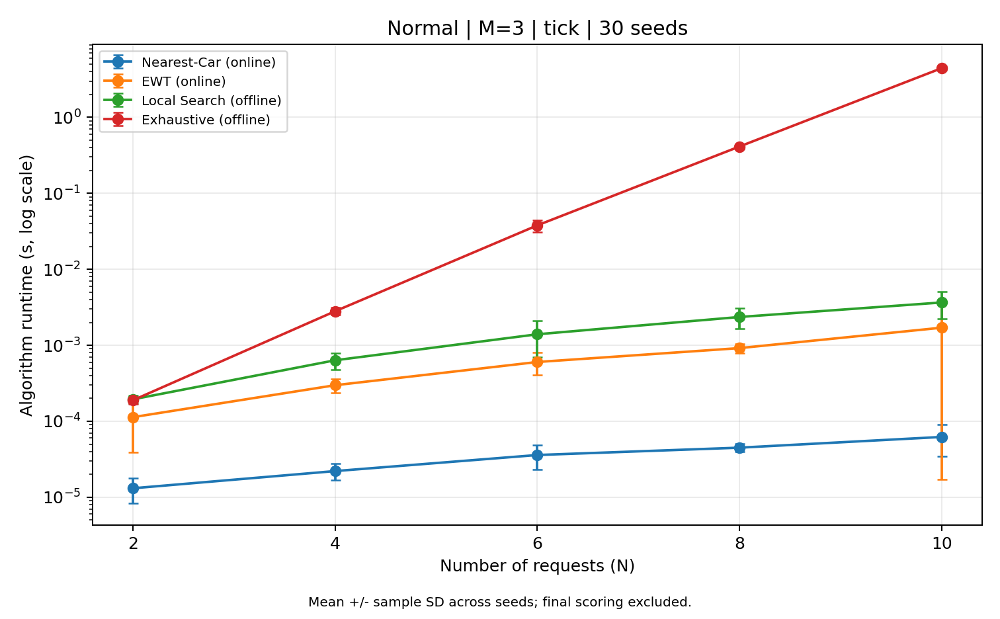
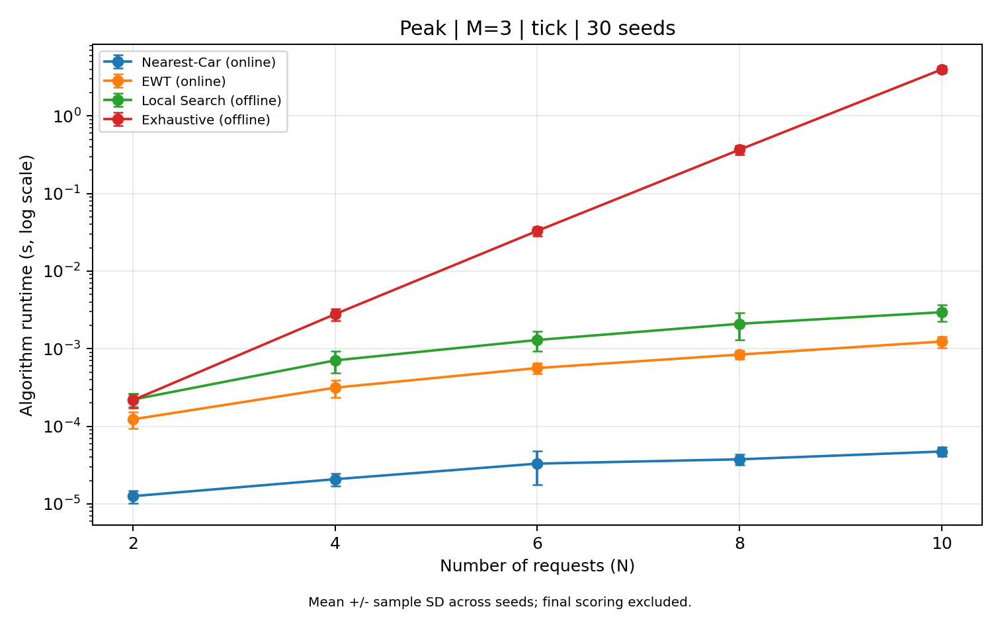

# normal/peak별 30개 seed 최종 실험

실행일: 2026-11-04 (Asia/Seoul). 테스트 42개를 통과한 코드로 시나리오별, N별 30개 seed를 순차 실행했다.
입력 480개, 결과 1,920행 중 정상 측정 1,740행과 전수탐색 생략 180행을 저장했다.
저장된 입력 480개를 seed로 재생성해 일치를 확인했고, 정상 배정표 1,740개를 다시 tick 채점해 CSV와 일치함을 확인했다.

## 코드 및 팀원 검토 반영

- `main` 기준: `1cb58a2834cfdca5dd61b69f4eadcbe8e08e7220`.
- 실제 검증·측정 기준: B의 `feature/part-b-2`, `3d06af42587bc1a1ae307d74396fd7deb7bf1b53`.
- B의 추가 변경은 테스트 보강뿐이며 Simulator·알고리즘·입력 생성·실험 실행·기본 그래프 코드는 main과 동일하다.
- A/B 기존 테스트 27개와 C 테스트 15개, 총 42개가 통과했다. Simulator·알고리즘 원본은 변경하지 않았다.
- 실행에 사용한 소스의 SHA-256과 환경은 [environment.json](environment.json), 결과 대조 기록은 [verification.json](verification.json)에 있다.

## 실험 조건

| 항목 | 조건 |
|---|---|
| 컴퓨터 | Apple M3, 16 GiB 메모리, 물리/논리 코어 각 8개 |
| 소프트웨어 | Python 3.12.4, matplotlib 3.10.3, macOS-26.6.2-arm64-arm-64bit |
| 운행 | 20층, 3대, 초기 위치 1·10·20층, 이동 2초, 정차 5초, 정원 제한 없음, 승하차 추가 시간 0초 |
| 시뮬레이션 | 모든 알고리즘 내부와 결과 채점은 tick |
| 입력 크기 N | 2, 4, 6, 8, 10, 20, 30, 50 |
| 시나리오 및 반복 | normal/peak 각각, 각 N마다 seed 0~29의 30개 입력 |
| 전수탐색 | N≤10에서 모든 3^N 후보 평가; 한도 59,049개 |
| 큰 입력 | N=20·30·50은 Nearest-Car·EWT·Local Search 측정, Exhaustive는 `assignment_limit`으로 생략 |
| 시간 측정 | 배정 함수만 측정. 내부 시뮬레이션 포함, 최종 채점·입력 복사·파일 저장 제외 |
| 실행 방식 | 알고리즘을 병렬 실행하지 않고, seed에 따라 실행 순서 회전. 각 입력의 함수 호출은 1회 측정 |

normal은 서로 다른 두 층을 균등 추출한다. peak는 80% 확률로 1층→상층, 나머지는 normal과 같이 추출한다.
따라서 실제 로비 상행 비율이 정확히 80%로 고정되지는 않는다. 도착 간격은 두 시나리오 모두 0~10초 정수 균등 추출이다.
이 값들은 실험용 가정이며 산업 통계값으로 사용하지 않는다.

## N=10: 네 알고리즘 비교

아래 값은 각 지표의 seed 평균 ± 표본 표준편차다. 최대 대기시간 열은 각 입력의 최대 대기시간을 30개 seed에 걸쳐 평균 낸 값이다.

### normal

| 알고리즘 | 평균 대기시간(s) | 최대 대기시간(s) | 계산 시간(s) | 상대 gap 평균(%) |
|---|---:|---:|---:|---:|
| Nearest-Car | 24.663 ± 8.098 | 74.600 ± 19.031 | 0.000062 ± 0.000028 | 115.37 (유효 30/30) |
| EWT Greedy | 15.440 ± 4.023 | 41.000 ± 11.656 | 0.001704 ± 0.001982 | 33.60 (유효 30/30) |
| Local Search | 14.007 ± 3.470 | 38.467 ± 11.557 | 0.003659 ± 0.001422 | 20.44 (유효 30/30) |
| Exhaustive | 11.740 ± 2.280 | 34.200 ± 9.415 | 4.437362 ± 0.259866 | 0.00 (유효 30/30) |

### peak

| 알고리즘 | 평균 대기시간(s) | 최대 대기시간(s) | 계산 시간(s) | 상대 gap 평균(%) |
|---|---:|---:|---:|---:|
| Nearest-Car | 28.347 ± 11.785 | 69.200 ± 19.670 | 0.000047 ± 0.000007 | 279.28 (유효 30/30) |
| EWT Greedy | 11.740 ± 3.814 | 32.700 ± 8.945 | 0.001236 ± 0.000203 | 53.91 (유효 30/30) |
| Local Search | 10.680 ± 3.207 | 32.433 ± 7.842 | 0.002951 ± 0.000712 | 39.12 (유효 30/30) |
| Exhaustive | 8.020 ± 2.393 | 28.933 ± 11.765 | 3.968272 ± 0.392181 | 0.00 (유효 30/30) |

상대 gap은 입력별 `(알고리즘 평균 대기시간 - 최적 평균 대기시간) / 최적 평균 대기시간`의 유효값 평균이다.
seed별 평균 대기시간을 먼저 합쳐서 계산한 비율과는 다르다. 최적=0·알고리즘=0이면 0,
최적=0·알고리즘>0이면 상대 gap은 빈칸이고 절대 gap은 유지한다. 유효 개수는 요약 CSV에도 저장했다.

## N=50: 큰 입력 비교

### normal

| 알고리즘 | 평균 대기시간(s) | 최대 대기시간(s) | 계산 시간(s) | 상대 gap 평균(%) |
|---|---:|---:|---:|---:|
| Nearest-Car | 49.041 ± 7.322 | 145.233 ± 14.642 | 0.000264 ± 0.000040 | — |
| EWT Greedy | 25.839 ± 4.675 | 95.267 ± 22.580 | 0.020528 ± 0.001081 | — |
| Local Search | 22.397 ± 3.548 | 80.933 ± 20.591 | 0.083144 ± 0.027159 | — |
| Exhaustive | 생략 | 생략 | 생략 | — |

### peak

| 알고리즘 | 평균 대기시간(s) | 최대 대기시간(s) | 계산 시간(s) | 상대 gap 평균(%) |
|---|---:|---:|---:|---:|
| Nearest-Car | 46.040 ± 6.356 | 124.967 ± 15.048 | 0.000225 ± 0.000033 | — |
| EWT Greedy | 16.006 ± 2.119 | 48.967 ± 9.915 | 0.018125 ± 0.000907 | — |
| Local Search | 14.926 ± 1.618 | 54.833 ± 13.807 | 0.061881 ± 0.018515 | — |
| Exhaustive | 생략 | 생략 | 생략 | — |

최적값을 측정하지 않은 큰 입력은 gap을 계산하지 않았다. 모든 N의 평균·표준편차는 [results_summary.csv](results_summary.csv)에 있다.

## 관찰 결과

- normal, N=10: 평균 대기시간은 Exhaustive 11.740초, Local Search 14.007초, EWT 15.440초, Nearest-Car 24.663초였다.
- normal, N=10: Exhaustive/EWT의 평균 계산 시간 비율은 약 2,604배였다. 온라인/오프라인의 정보 수준 차이를 함께 해석해야 한다.
- peak, N=10: 평균 대기시간은 Exhaustive 8.020초, Local Search 10.680초, EWT 11.740초, Nearest-Car 28.347초였다.
- peak, N=10: Exhaustive/EWT의 평균 계산 시간 비율은 약 3,210배였다. 온라인/오프라인의 정보 수준 차이를 함께 해석해야 한다.
- 전체 480개 입력에서 Local Search의 평균 대기시간이 EWT보다 커진 경우는 없었다.
- 평균 대기시간 개선이 최대 대기시간 개선을 보장하지는 않았다. peak N=50에서 Local Search의 최대 대기시간 평균은 54.833초로 EWT의 48.967초보다 컸다. Local Search는 평균을 개선하는 목적 함수이므로 이 결과도 그대로 제시한다.
- Exhaustive의 최적성은 고정된 운행 규칙 아래 배정 공간에 대한 것이다. 운행 규칙이나 승객 처리 순서를 추가로 최적화한 결과가 아니다.

## 탐색 범위를 정하기 위한 별도 예비 측정

공식 30개 seed 실험 전에 각 조건의 seed=0 한 건을 측정했다. 이 예비 수치는 최종 평균·그래프에 섞지 않았다.

| 시나리오 | N | 후보 수 | 전수탐색 시간(s) |
|---|---:|---:|---:|
| normal | 8 | 6,561 | 0.407 |
| normal | 10 | 59,049 | 4.503 |
| normal | 12 | 531,441 | 46.557 |
| peak | 8 | 6,561 | 0.410 |
| peak | 10 | 59,049 | 4.401 |
| peak | 12 | 531,441 | 48.226 |

N=12도 한 입력의 정확 탐색은 완료했지만, 전체 60개 입력의 비용을 고려해 본 실험은 N≤10으로 범위를 정했다.
큰 N의 생략은 후보 한도 정책이며, 실제 시간 초과나 계산 불가능을 실증한 결과로 표현하지 않는다.

## 결과 파일과 그래프

- [results.csv](results.csv): 모든 원시 결과, 배정표, 대기시간, 계산 시간, gap, skip 이유.
- [results_summary.csv](results_summary.csv): 64개 조건의 seed 평균·표본 표준편차·유효 개수.
- `results_inputs/`: 비교에 사용한 JSON 입력 480개.
- [run.log](run.log): 실행 진행 기록.
- [pilot.csv](pilot.csv): seed=0의 별도 예비 측정.
- `plots/`: 시나리오별 평균·최대 대기시간, 계산 시간, gap 그래프 8장과 작은 입력 계산 시간 확대 그래프 2장.
- gap 그래프는 정확 최적값을 측정한 N≤10만 표시한다.






## 재현 방법

저장소 루트에서 같은 소스 버전을 사용한다. 아래 명령은 기존 결과를 보존하도록 다른 폴더에 저장한다.

```bash
python3 -m experiment.run --n 2 4 6 8 10 20 30 50 --seeds 0 1 2 3 4 5 6 7 8 9 10 11 12 13 14 15 16 17 18 19 20 21 22 23 24 25 26 27 28 29 --max-assignments 59049 --output results/reproduced_30seeds/results.csv
python3 -m experiment.plot results/reproduced_30seeds/results.csv --output-dir results/reproduced_30seeds/plots
```

환경과 명령 원문은 environment.json에 기록했다. 입력과 대기시간은 동일 조건에서 재현되며, 계산 시간은 실행 환경에 따라 달라진다.
첨부된 최종 데이터의 재검증과 그래프 10장·이 보고서 재생성은 `python3 -m experiment.report_final`로 실행한다.
해당 코드는 [experiment/report_final.py](../../experiment/report_final.py)에 있다. 이 명령은 최적화 알고리즘의 계산 시간을 다시 측정하지 않는다.
표준편차는 서로 다른 seed 간 변동으로, 동일 입력의 반복 시간 측정에 대한 오차 범위가 아니다.
Codex가 실행 중인 사용자 컴퓨터에서 측정했으며 다른 프로그램의 종료나 백그라운드 부하를 통제하지 않았다.
그래프의 계산 시간은 로그축이고, 오차 막대 하단이 0 이하일 때 표시 가능한 양수 범위로 제한했다.

C 코드·결과 정리·보고서는 생성형 AI(Codex)의 도움으로 작성하고 위 검증을 수행했다.
